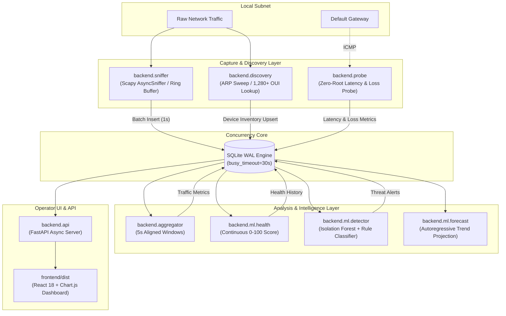

# NetWatch - AI-Powered Network Monitoring & Anomaly Detection Dashboard

[]()
[]()
[]()
[]()
[]()

NetWatch is an autonomous, lightweight Network Operations Center (NOC) dashboard designed for Computer Networks laboratory demonstrations, enterprise edge monitoring, and real-time cyber defense. 

It passively sniffs local network traffic, maintains device inventories with offline MAC OUI vendor resolution, aggregates flow statistics, computes objective continuous health scores, projects bandwidth demand with regression models, and flags cyber threats (e.g. port scans, SYN floods, ICMP storms, bandwidth hogs, unknown devices) using a hybrid pipeline of **Isolation Forest** machine learning and deterministic signature heuristics.

---

## Architecture Overview

NetWatch completely decouples high-speed packet capture from computationally intensive machine learning inference via **SQLite WAL (Write-Ahead Logging)** mode and thread-safe batching. Model execution never introduces backpressure or packet drops.



---

## Key Features

1. **Passive Deep Packet Inspection**:
   - Captures Ethernet, IPv4, IPv6, TCP, UDP, ICMP, DNS (port 53), and ARP frames.
   - Parses flags, packet lengths, ports, and timestamps.
   - Non-blocking ring buffer with packet drop counters.

2. **Autonomous Device Discovery & Baseline**:
   - Zero-configuration ARP sweep of the auto-detected LAN subnet.
   - Fully offline MAC OUI resolution using an embedded dataset of 1,280+ hardware vendors.
   - Host whitelist toggle (`is_known`) and automated offline device transition.

3. **Hybrid Anomaly Detection**:
   - **Isolation Forest**: Learns normal traffic distributions from recorded baseline intervals.
   - **Deterministic Rules**: Catches port scans, SYN floods, ICMP spikes, and bandwidth hogs with magnitude-based severity scaling (low, medium, high).
   - **Anti-Spam Filter**: 30-second cooldown per `(src_ip, alert_type)` with alert repetition merging.

4. **Continuous Network Health Scoring**:
   - Dynamic 0–100 health score penalizing unacknowledged alerts (up to 45 pts), packet loss (up to 35 pts), and excess round-trip latency (up to 20 pts).
   - Instant categorization into **Healthy** ($\ge 80$), **Degraded** ($50 - 79.9$), or **Critical** ($< 50$).

5. **Single-Port Unified Dashboard**:
   - Dark NOC dashboard built with Vite, React 18, and Chart.js.
   - Live ingress/egress bandwidth chart with projected 5-minute forecast dashed line.
   - Protocol breakdown doughnut chart, top talkers, device inventory with whitelist toggle, and real-time threat feed with acknowledgement controls.

---

## Project Structure

```
NetWatch/
├── backend/
│   ├── config.py            # Centralized settings & dynamic subnet/interface auto-detection
│   ├── db.py                # SQLite schema (WAL), batch inserts, and aggregation queries
│   ├── discovery.py         # Subnet ARP sweeper, reverse DNS, and offline MAC OUI vendor lookup
│   ├── sniffer.py           # Multi-threaded Scapy sniffer with ring buffer and batch writer
│   ├── aggregator.py        # Sliding metric aggregator (5s windows) & retention manager
│   ├── probe.py             # Zero-root gateway round-trip latency & packet loss probe
│   ├── api.py               # FastAPI REST endpoints & production React static file host
│   ├── run_all.py           # Unified process supervisor with auto-restart & clean shutdown
│   ├── data/
│   │   └── oui.csv          # Embedded IEEE MAC OUI manufacturer database (1,280+ vendors)
│   └── ml/
│       ├── features.py      # Feature engineering matrix (pps, syn_ratio, unique_dst_ports, etc.)
│       ├── train.py         # Isolation Forest pipeline trainer
│       ├── detector.py      # Real-time anomaly detector daemon
│       ├── rules.py         # Heuristic attack signature engine
│       ├── health.py        # Objective network health evaluator
│       └── forecast.py      # Autoregressive bandwidth demand forecaster
├── frontend/                # React 18 + Chart.js dashboard (Vite)
│   ├── src/                 # Dashboard components, API client, and theme
│   └── dist/                # Pre-built production bundle hosted directly by FastAPI
├── scripts/
│   ├── simulate_traffic.py  # Realistic background traffic & cyber attack vector injector
│   └── record_baseline.py   # Baseline recorder and training dataset snapshot generator
├── deploy/
│   ├── install.sh           # One-step production installer for Ubuntu / Debian
│   └── netwatch.service     # Systemd production service definition
├── tests/                   # Complete automated pytest test suite (35 tests)
├── requirements.txt         # Python dependencies
└── README.md
```

---

## Installation & Setup

### Option A: Automated Ubuntu / Debian Installer (Recommended)

Run the automated installer to set up all system dependencies, Python virtual environment, Linux capabilities, frontend build, and systemd service:

```bash
sudo bash deploy/install.sh
```

### Option B: Manual Installation

#### 1. Install System Dependencies (Ubuntu / Debian)
```bash
sudo apt update
sudo apt install -y python3 python3-pip python3-venv libpcap-dev iputils-ping nodejs npm libcap2-bin
```

#### 2. Configure Python Virtual Environment
```bash
python3 -m venv venv
source venv/bin/activate
pip install --upgrade pip setuptools wheel
pip install -r requirements.txt
```

#### 3. Grant Packet Capture Privileges (Optional - allows non-root sniffing)
```bash
sudo setcap cap_net_raw,cap_net_admin=eip $(readlink -f venv/bin/python)
```

#### 4. Build the React Dashboard
```bash
cd frontend
npm install
npm run build
cd ..
```

#### 5. Initialize the SQLite WAL Database
```bash
python -m backend.db --init
```

---

## Running NetWatch

### 1. Production Mode (Full Live Capture)
Start all microservices (discovery, sniffer, aggregator, probe, detector, and web server) under the supervisor:

```bash
sudo python -m backend.run_all
```
Open your browser to:
- **Dashboard UI**: [http://localhost:8000](http://localhost:8000)
- **Interactive OpenAPI Docs**: [http://localhost:8000/docs](http://localhost:8000/docs)

### 2. Simulation Mode (Driverless / No-Root)
To test and demonstrate the full stack on any system without network drivers or root privileges:

```bash
python -m backend.run_all --no-capture
```
In a separate terminal, inject realistic traffic and attack scenarios:
```bash
python -m scripts.simulate_traffic --minutes 15 --devices 8 --attack portscan synflood
```

### 3. Background Systemd Service
If installed via `deploy/install.sh`:
```bash
# Start NetWatch daemon
sudo systemctl start netwatch

# View live log output
sudo journalctl -u netwatch -f

# Check operational status
sudo systemctl status netwatch
```

---

## Machine Learning Lifecycle

### 1. Record Normal Network Baseline
Run normal network activity (web browsing, streaming, typical office workloads) while NetWatch records telemetry:

```bash
# Record live baseline for 10 minutes
python -m scripts.record_baseline --minutes 10 --name "normal_office_baseline"

# Or designate recent history as baseline:
python -m scripts.record_baseline --from-history --minutes 30 --name "clean_history"
```

### 2. Train Isolation Forest Model
Train the scikit-learn anomaly detection pipeline on the recorded baseline:

```bash
python -m backend.ml.train --contamination 0.02
```
This fits a `StandardScaler` + `IsolationForest` pipeline across feature vectors (`pps`, `bytes_out`, `bytes_in`, `syn_count`, `icmp_count`, `unique_dst_ports`, `unique_dst_ips`, `syn_ratio`) and saves `backend/ml/model.joblib`.

### 3. Real-Time Detection
Once `model.joblib` is saved, the detector automatically switches to **Hybrid Mode** (ML + deterministic rules), displaying anomaly confidence scores on detected threats.

---

## Penetration Testing & Kali Attack Guide

To validate NetWatch in a laboratory or demo environment, launch the following simulated attacks from a Kali Linux machine against the NetWatch victim IP.

Set your target environment variable:
```bash
export VICTIM_IP=192.168.1.50   # Replace with your NetWatch host IP
```

| Attack Type | Kali Linux Command | Expected NetWatch Alert | Severity |
| :--- | :--- | :--- | :---: |
| **Port Scan (SYN)** | `nmap -sS -T4 -p 1-1000 $VICTIM_IP` | `Port scan detected from <SRC_IP>: ~1000 unique destination ports probed` | `high` |
| **Port Scan (Connect)** | `nmap -sT -F $VICTIM_IP` | `Port scan detected from <SRC_IP>: 100 unique destination ports probed` | `medium` |
| **SYN Flood** | `sudo hping3 -S -p 80 --flood --rand-source $VICTIM_IP` | `SYN flood detected from <SRC_IP>: >200 SYN packets without ACK` | `high` |
| **ICMP Flood** | `sudo hping3 --icmp --flood $VICTIM_IP` | `ICMP flood detected from <SRC_IP>: >150 ICMP packets in 5s window` | `high` |
| **Bandwidth Hog** | `iperf3 -c $VICTIM_IP -u -b 50M -t 15` | `High bandwidth consumption from <SRC_IP>: ~50 MB transmitted` | `high` |
| **Host Sweep** | `nmap -sn 192.168.1.0/24` | `New unknown device detected` | `medium` |

---

## REST API Reference

NetWatch provides an asynchronous REST API documented with OpenAPI at `/docs`:

- `GET /api/status`: Operational telemetry, capture status, SQLite disk size, network interface, and subnet.
- `GET /api/devices`: Complete inventory of discovered network hosts with online/offline status and hardware vendor.
- `POST /api/devices/{mac}/known`: Toggle whitelist flag (`is_known`) for a host.
- `GET /api/traffic?minutes=15`: Chronological time series of ingress/egress throughput (bps), packets/sec, ping latency, and packet loss.
- `GET /api/protocols?minutes=15`: Breakdown of TCP, UDP, ICMP, DNS, and other protocols.
- `GET /api/top-talkers?minutes=15&limit=10`: Top bandwidth-consuming hosts.
- `GET /api/alerts?limit=50&severity=high`: Chronological AI anomaly and threat alerts feed.
- `POST /api/alerts/{id}/ack`: Acknowledge and dismiss an active alert.
- `GET /api/health`: Continuous 0–100 network health score, qualitative status (`Healthy`, `Degraded`, `Critical`), and trend history.
- `GET /api/forecast`: Autoregressive predicted network bandwidth demand for the next 5 minutes with confidence intervals.

---

## Automated Test Suite

NetWatch includes a comprehensive unit and integration test suite covering the database engine, feature extraction, heuristic threat classification, health scoring, and REST endpoints:

```bash
# Run all tests
python -m pytest tests/ -v
```

Output:
```text
tests/test_api.py::test_api_status PASSED                                [  2%]
tests/test_api.py::test_api_devices PASSED                               [  5%]
tests/test_api.py::test_api_device_toggle_known PASSED                   [  8%]
tests/test_api.py::test_api_traffic PASSED                               [ 11%]
tests/test_api.py::test_api_protocols PASSED                             [ 14%]
tests/test_api.py::test_api_top_talkers PASSED                           [ 17%]
tests/test_api.py::test_api_alerts_and_ack PASSED                        [ 20%]
tests/test_api.py::test_api_health PASSED                                [ 22%]
tests/test_api.py::test_api_forecast PASSED                              [ 25%]
tests/test_db.py::test_init_db_and_wal_mode PASSED                       [ 28%]
tests/test_db.py::test_packet_flows_batch_insert_and_unprocessed PASSED  [ 31%]
tests/test_db.py::test_traffic_metrics_upsert_and_probe_update PASSED    [ 34%]
tests/test_db.py::test_device_inventory_upsert_and_offline PASSED        [ 37%]
tests/test_db.py::test_ai_alerts_insert_and_acknowledge PASSED           [ 40%]
tests/test_db.py::test_health_history_and_status PASSED                  [ 42%]
tests/test_db.py::test_system_status_and_top_talkers PASSED              [ 45%]
tests/test_db.py::test_cleanup_old_records PASSED                        [ 48%]
tests/test_features.py::test_feature_columns_definition PASSED           [ 51%]
tests/test_features.py::test_extract_features_empty_input PASSED         [ 54%]
tests/test_features.py::test_extract_features_missing_columns PASSED     [ 57%]
tests/test_syn_ratio_calculation PASSED                                  [ 60%]
tests/test_features.py::test_extract_features_with_metadata PASSED       [ 62%]
tests/test_health.py::test_health_score_ideal_conditions PASSED          [ 65%]
tests/test_health.py::test_alert_penalties_and_capping PASSED            [ 68%]
tests/test_health.py::test_packet_loss_penalty_and_capping PASSED        [ 71%]
tests/test_health.py::test_latency_penalty_and_capping PASSED            [ 74%]
tests/test_health.py::test_worst_case_clamping_to_zero PASSED            [ 77%]
tests/test_health.py::test_health_labels PASSED                          [ 80%]
tests/test_health.py::test_evaluate_and_record_health_integration PASSED [ 82%]
tests/test_rules.py::test_clean_window_produces_no_alerts PASSED         [ 85%]
tests/test_rules.py::test_port_scan_detection_and_severity PASSED        [ 88%]
tests/test_rules.py::test_syn_flood_detection PASSED                     [ 91%]
tests/test_rules.py::test_icmp_flood_detection PASSED                    [ 94%]
tests/test_rules.py::test_bandwidth_hog_detection PASSED                 [ 97%]
tests/test_rules.py::test_multi_attack_window PASSED                     [100%]

============================= 35 passed in 7.15s ==============================
```

---

## Troubleshooting Guide

### 1. Permission Denied on Raw Packet Capture
- **Symptom**: `PermissionError: [Errno 1] Operation not permitted` or Scapy socket errors.
- **Solution**:
  - Run with `sudo`: `sudo python -m backend.run_all`
  - Or grant Linux capabilities to your virtual environment Python binary:
    ```bash
    sudo setcap cap_net_raw,cap_net_admin=eip $(readlink -f venv/bin/python)
    ```

### 2. Interface Selection
- **Symptom**: NetWatch defaults to an inactive interface (e.g. docker0 or loopback).
- **Solution**:
  - Specify the network interface explicitly:
    ```bash
    sudo python -m backend.run_all --iface eth0
    ```
  - Or set the environment variable:
    ```bash
    export NETWATCH_INTERFACE=eth0
    ```

### 3. SQLite Busy / Lock Timeouts
- **Symptom**: `sqlite3.OperationalError: database is locked`.
- **Solution**:
  - NetWatch automatically activates SQLite **WAL mode** (`PRAGMA journal_mode = WAL`) and sets a **30-second busy timeout** (`PRAGMA busy_timeout = 30000`).
  - Ensure the database is stored on a local filesystem (ext4, xfs, NTFS) and **not** an NFS or CIFS network mount, which do not reliably support POSIX file locks.

### 4. Firewall (UFW)
- Ensure port 8000 is permitted through your host firewall:
  ```bash
  sudo ufw allow 8000/tcp
  sudo ufw reload
  ```

---

## License

This project is licensed under the MIT License.
